Mermaid allows you to create diagrams using text directly inside Markdown. Obsidian supports Mermaid natively.

---
## **1. Basic Syntax**

Use a `mermaid` code block:

````markdown
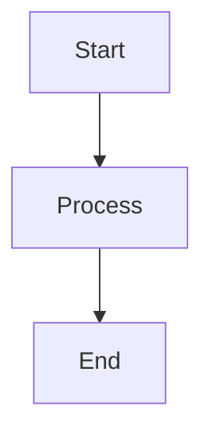
````

---

## **2. Flowcharts**

### **Direction**

```text
TD = Top → Down
TB = Top → Bottom
LR = Left → Right
RL = Right → Left
BT = Bottom → Top
```

Example:

````markdown
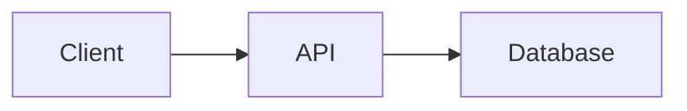
````

---

## **3. Node Shapes**

```text
A[Rectangle]

A(Rounded Rectangle)

A([Stadium])

A((Circle))

A{Diamond / Decision}

A[(Database)]

A[[Subroutine]]

A>Asymmetric]
```

Example:

````markdown
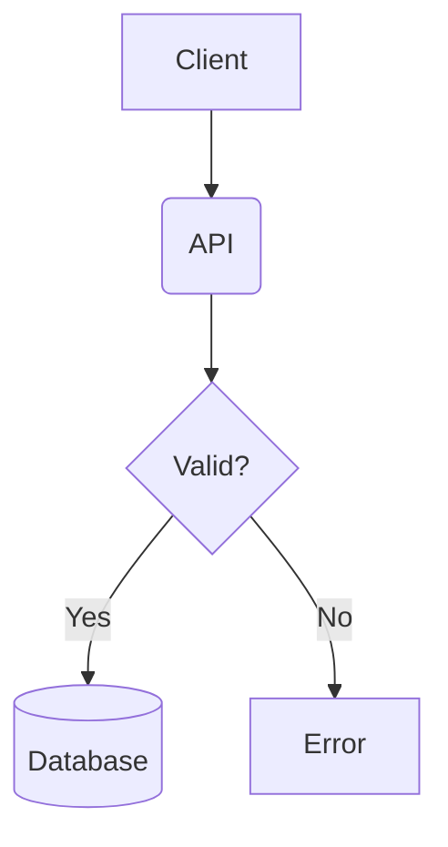
````

---

## **4. Arrows and Connections**

### **Normal Arrow**

```text
A --> B
```

### **Line**

```text
A --- B
```

### **Dashed Arrow**

```text
A -.-> B
```

### **Thick Arrow**

```text
A ==> B
```

### **Arrow with Label**

```text
A -->|Request| B
```

### **Dashed Arrow with Label**

```text
A -.->|Event| B
```

Example:

````markdown
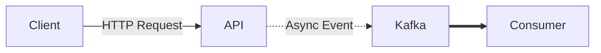
````

---

## **5. Decision / Conditional Flow**

Use a diamond `{}` for decisions.

````markdown
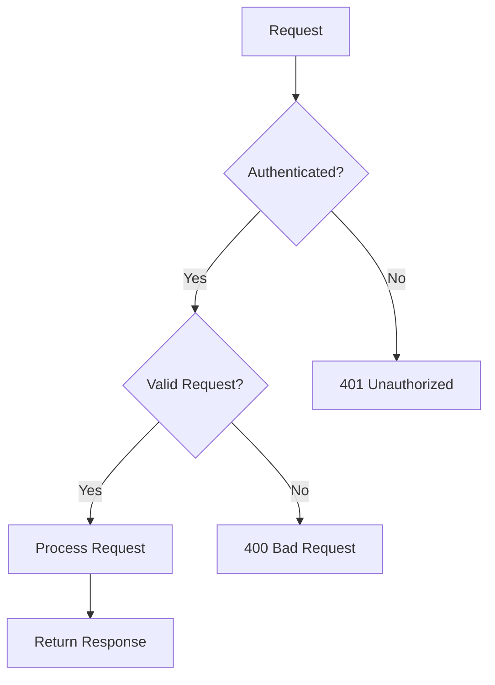
````

---

## **6. Subgraphs**

Use `subgraph` to group components.

````markdown
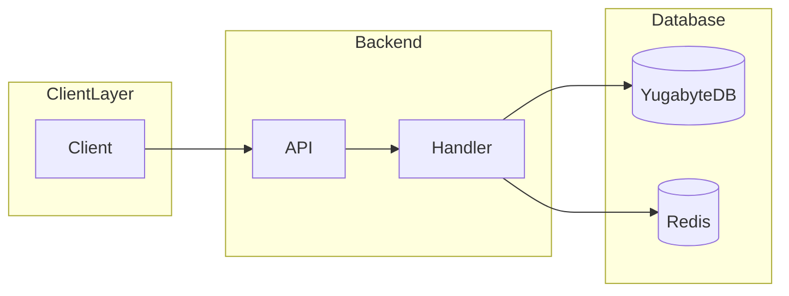
````

---

## **7. Sequence Diagrams**

Use sequence diagrams when you want to show **who communicates with whom and in what order**.

````markdown
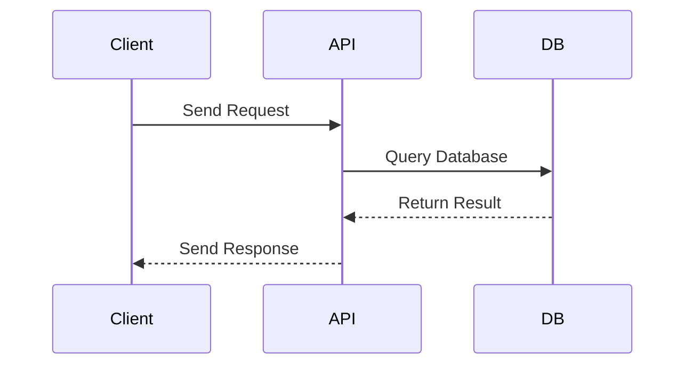
````

### **Common arrows**

```text
->>     Solid message
-->>    Dashed response
-)      Async message
-->>    Dashed response
```

---

## **8. Sequence Diagram with Conditions**

Use `alt` for different outcomes.

````markdown
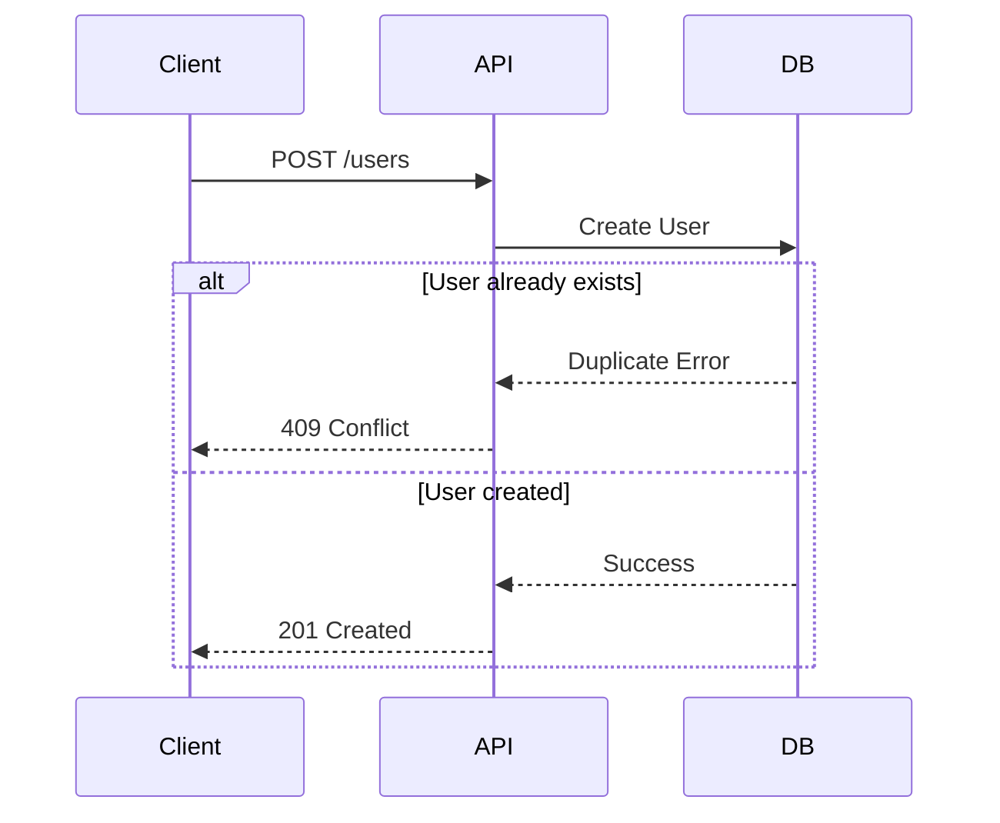
````

---

## **9. Sequence Diagram with Optional Flow**

Use `opt` for optional behavior.

````markdown
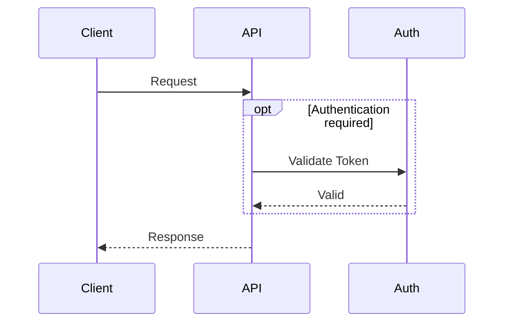
````

---

## **10. Loops**

Use `loop` when something happens repeatedly.

````markdown
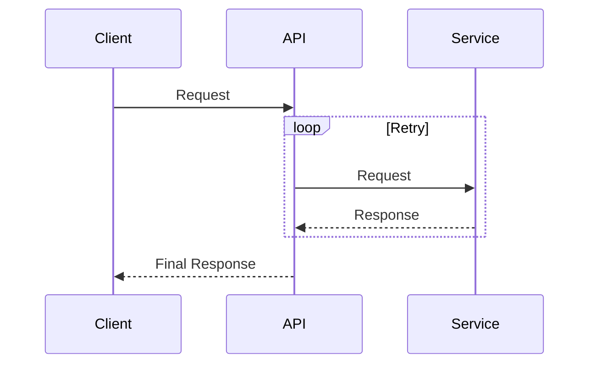
````

---

## **11. Notes in Sequence Diagrams**

````markdown
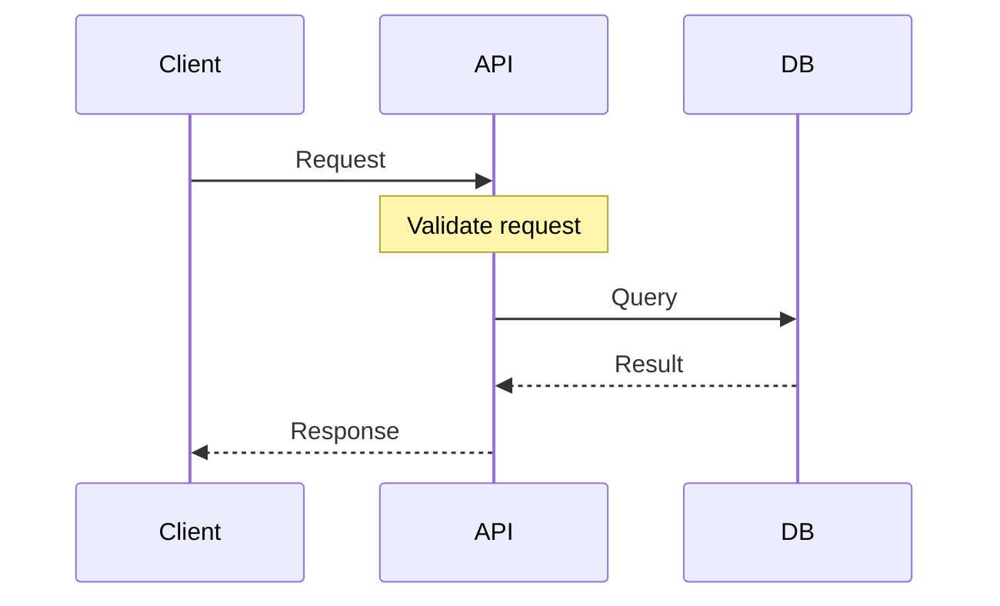
````

You can use:

```text
Note over A
Note over A,B
Note right of A
Note left of A
```

---

## **12. State Diagrams**

Use state diagrams to represent the lifecycle of an object.

````markdown
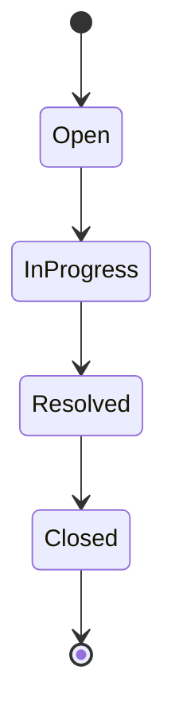
````

### **With transitions**

````markdown
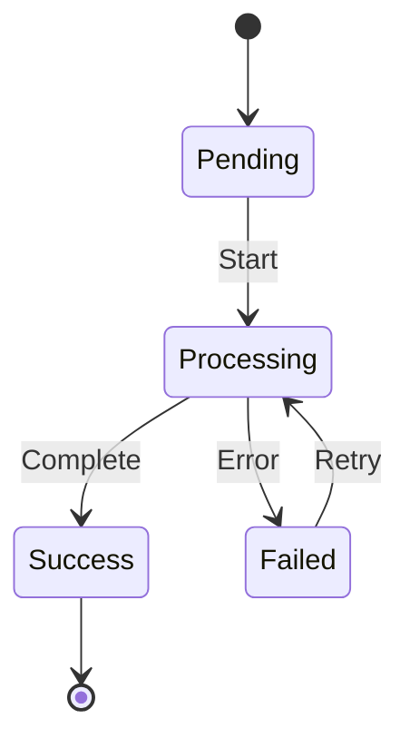
````

---

## **13. Entity Relationship Diagrams**

Use `erDiagram` to represent database relationships.

````markdown
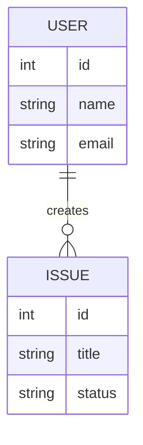
````

### **Common relationship symbols**

```text
||     Exactly one

o|     Zero or one

|{     One or many

o{     Zero or many
```

Example:

```text
USER ||--o{ ISSUE
```

means:

```text
One USER can have zero or many ISSUES.
```

---

## **14. Class Diagrams**

Useful for representing classes and their relationships.

````markdown
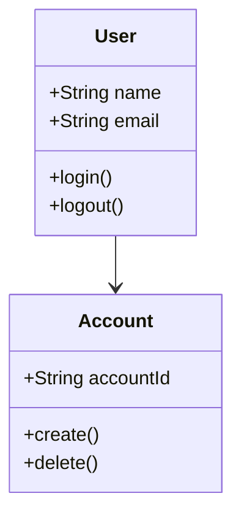
````

---

## **15. Git Graphs**

Mermaid can represent Git workflows.

````markdown
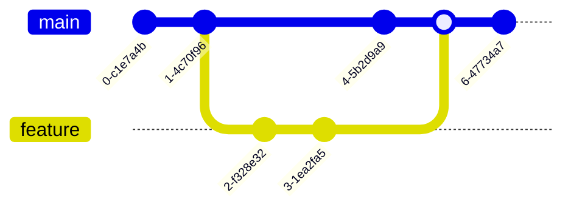
````

Useful for documenting:

- Feature branches
- Release branches
- Hotfixes
- Merge workflows

---

## **16. Kafka Architecture Example**

````markdown
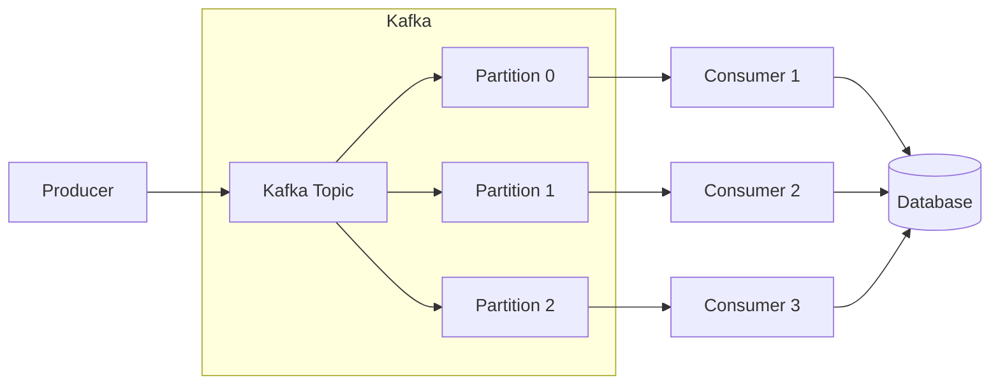
````

---

## **17. API Architecture Example**

````markdown
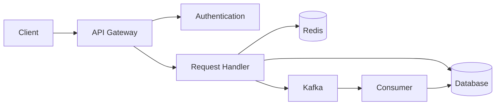
````

---

## **18. API Request Flow Example**

````markdown
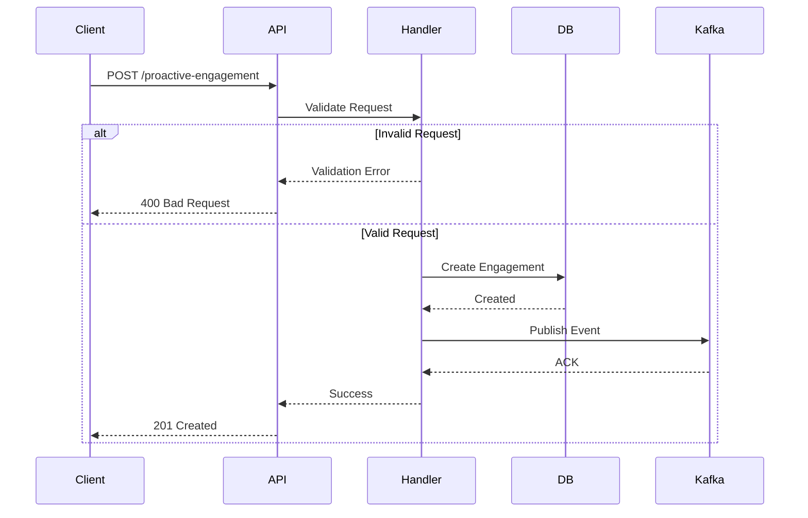
````

---

## **19. Debugging Flow Example**

````markdown
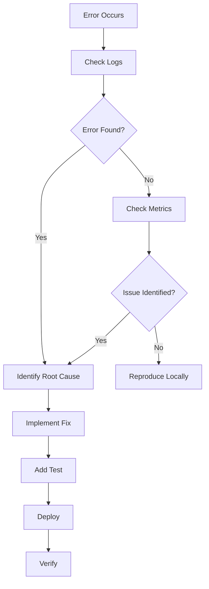
````

---

## **20. Mermaid Comments**

You can add comments using:

```text
%% This is a Mermaid comment
```

Example:

````markdown
```mermaid
flowchart LR
    %% Client sends request
    Client --> API

    %% API processes request
    API --> DB
```
````

---

## **21. Styling Nodes**

You can apply custom styles.

````markdown
```mermaid
flowchart LR
    A[Client] --> B[API]
    B --> C[(Database)]

    style A fill:#f9f
    style B fill:#bbf
    style C fill:#bfb
```
````

For most notes, you don’t need custom styling. Keeping diagrams simple makes them easier to maintain.

---

## **22. Linking Mermaid Diagrams to Obsidian Notes**

Mermaid itself doesn’t replace Obsidian links, so use Mermaid for the visual relationship and normal Obsidian links around it.

Example:

````markdown
# Kafka Architecture

See also:

- [[Kafka Producer]]
- [[Kafka Consumer]]
- [[Kafka Topic]]
- [[Kafka Partition]]

```mermaid
flowchart LR
    Producer --> Topic
    Topic --> Partition
    Partition --> Consumer
```
````

---

## **23. Which Mermaid Diagram Should I Use?**

|**Requirement**|**Mermaid Type**|
|---|---|
|System architecture|`flowchart`|
|Component relationships|`flowchart`|
|API request flow|`sequenceDiagram`|
|Kafka message flow|`flowchart` / `sequenceDiagram`|
|Database relationships|`erDiagram`|
|Object/class relationships|`classDiagram`|
|Lifecycle|`stateDiagram-v2`|
|Git workflow|`gitGraph`|
|Decision tree|`flowchart`|
|Debugging flow|`flowchart`|

---

## **24. Quick Cheat Sheet**

### **Flowchart**

````markdown
```mermaid
flowchart LR
    A --> B
```
````

### **Node**

```text
A[Rectangle]
A((Circle))
A{Decision}
A[(Database)]
```

### **Arrow**

```text
A --> B
A -->|Label| B
A -.-> B
A ==> B
```

### **Sequence**

````markdown
```mermaid
sequenceDiagram
    A->>B: Request
    B-->>A: Response
```
````

### **State**

````markdown
```mermaid
stateDiagram-v2
    [*] --> Pending
    Pending --> Complete
    Complete --> [*]
```
````

### **Database**

````markdown
```mermaid
erDiagram
    USER ||--o{ ISSUE : creates
```
````

### **Git**

````markdown
```mermaid
gitGraph
    commit
    branch feature
    checkout feature
    commit
    checkout main
    merge feature
```
````

---

## **25. Recommended Pattern for Your Technical Notes**

For a technical topic, structure your note like this:

````markdown
# Kafka

## Overview

What is Kafka?

## Architecture

```mermaid
flowchart LR
    Producer --> Kafka
    Kafka --> Consumer
    Consumer --> Database
````

## **Request / Message Flow**

```mermaid
sequenceDiagram
    Producer->>Kafka: Publish message
    Kafka->>Consumer: Deliver message
    Consumer->>Database: Store data
```

## **Components**

- [[Kafka Producer]]
- [[Kafka Consumer]]
- [[Kafka Topic]]
- [[Kafka Partition]]

## **Common Problems**

…

## **Debugging**

```mermaid
flowchart TD
    Error --> Logs
    Logs --> RootCause
    RootCause --> Fix
```

````
### Quick rule to remember

```text
Architecture      → flowchart
Communication     → sequenceDiagram
Lifecycle         → stateDiagram-v2
Database          → erDiagram
Classes           → classDiagram
Git workflow      → gitGraph
````